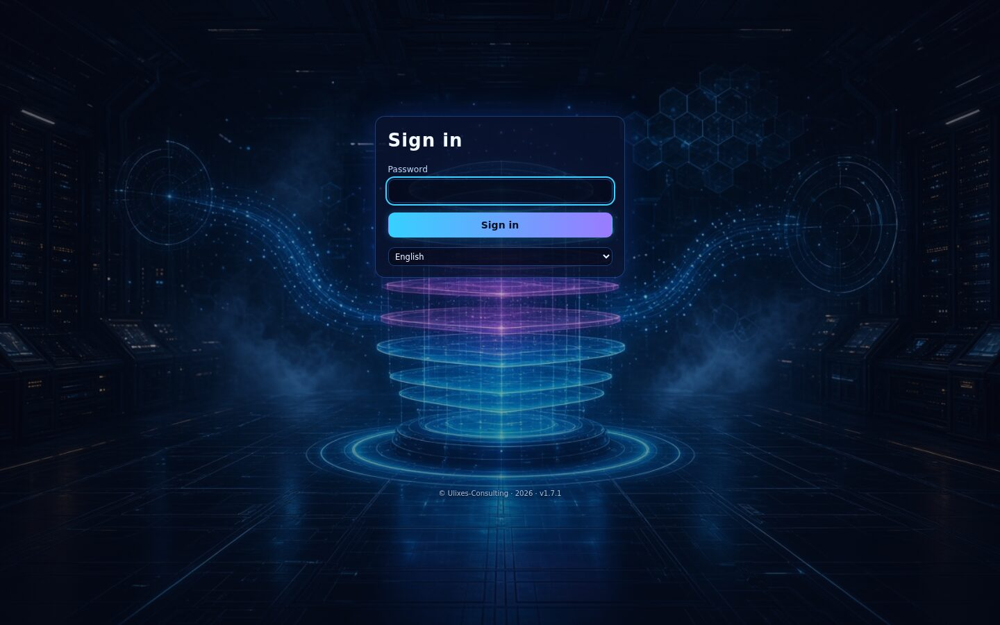
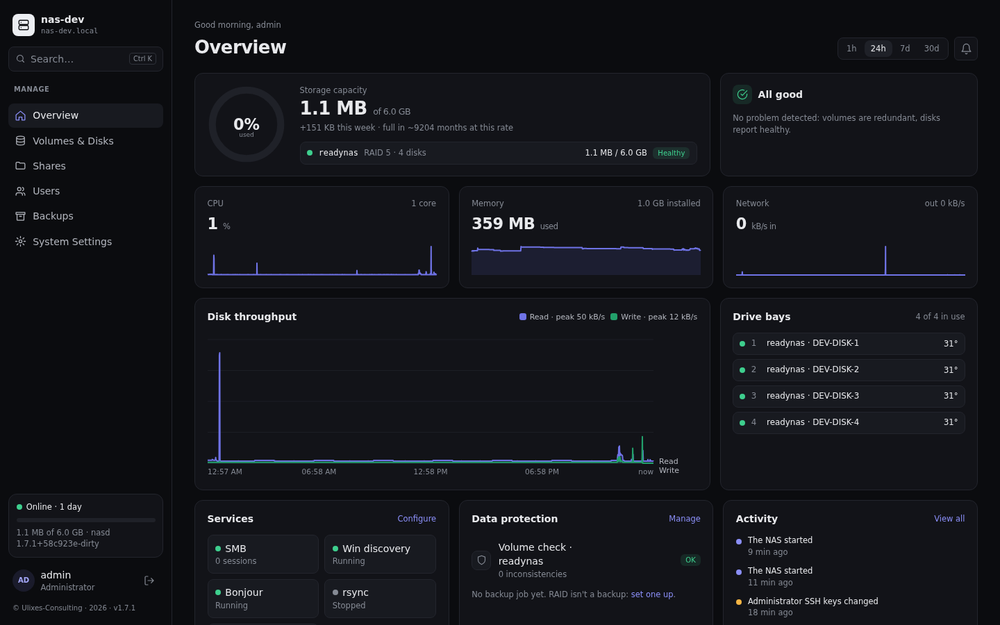
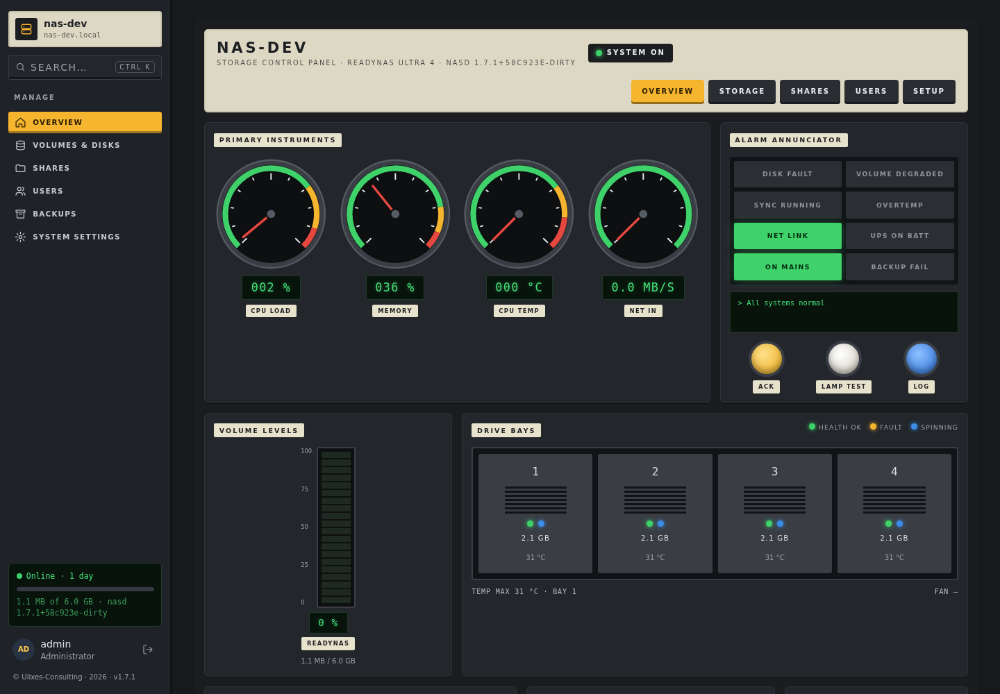
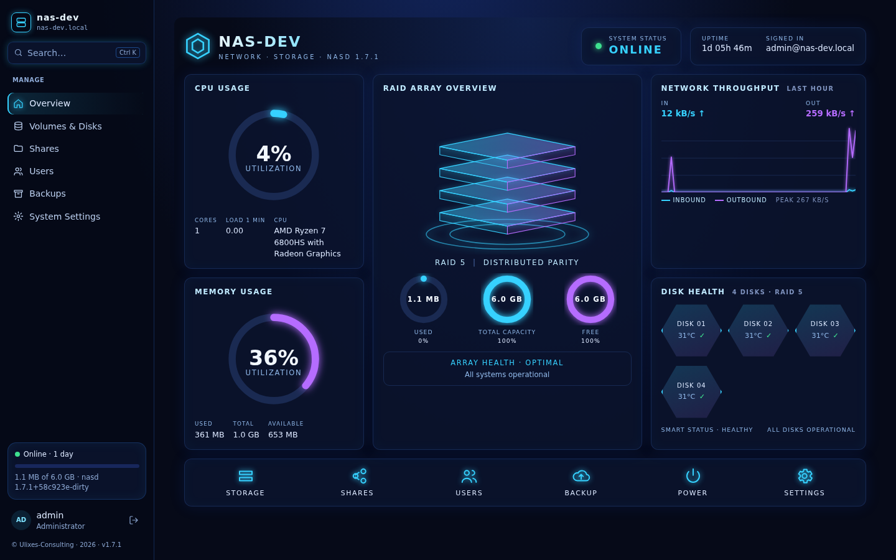
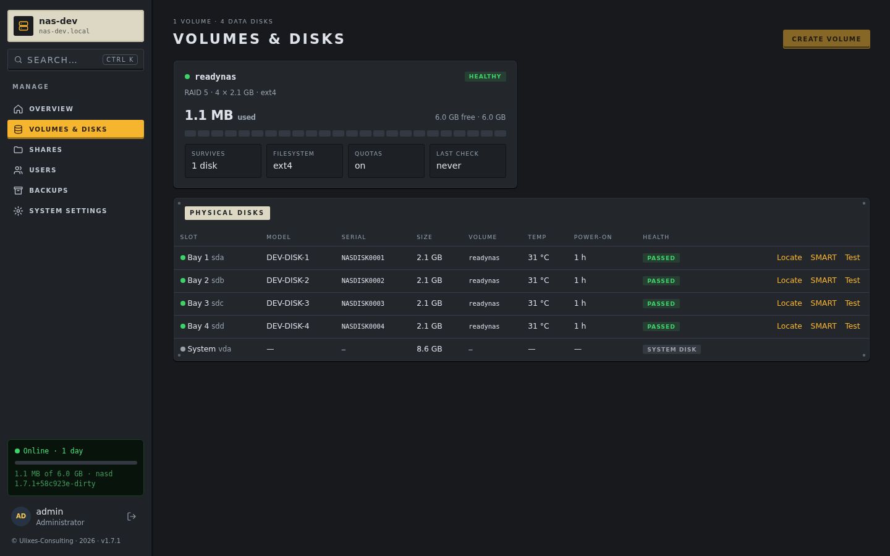
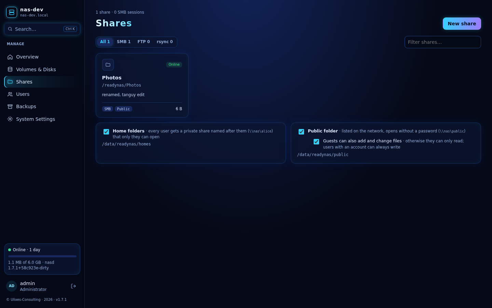
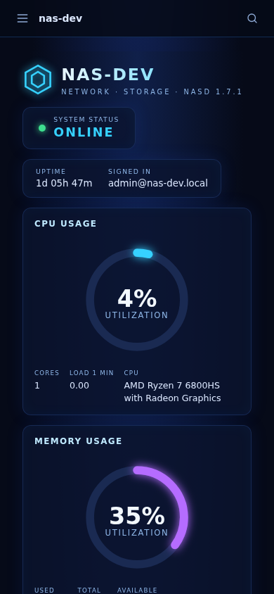

# nasd: a modern NAS system for the NETGEAR ReadyNAS Ultra 4

**Give a 2010 NAS a second life.** The ReadyNAS Ultra 4 is solid hardware
(4 bays, Atom D410, 1 GB RAM), but its system, RAIDiator, stopped receiving
updates years ago. It only speaks SMB1, which today's computers refuse, and
its web interface no longer opens in a current browser.

nasd replaces it with a current **Debian 13** system and a web interface
written for this machine, **front panel included**. Your existing RAIDiator
volume can be kept, files and all.



## What it does

- **Storage**: RAID 0/1/5/6/10 with mdadm, expansion, disk replacement,
  scheduled checks, SMART health, per-user quotas. **Adopts RAIDiator's
  volumes** (RAID + LVM) without copying anything.
- **Sharing**: SMB3 (Windows, macOS, Linux, phones), FTP/FTPS, rsync, Time
  Machine, private home folders, a **public folder** (with shares shown
  read-only inside it), offline shares, per-share network access.
- **Backups**: to USB disks, other NAS (rsync/SSH), a **cold cloud archive**
  (AWS S3 Glacier or Scaleway, encrypted), USB copy when a disk is plugged.
- **The front panel**, reverse-engineered for interoperability: the 2×16
  **display** (status, problems, progress), **bay LEDs** (Locate a disk),
  the **Backup button** (runs jobs; held 10 s it resets the admin password).
- **System**: fan control from disk temperatures, UPS (NUT), power schedule,
  Wake-on-LAN, network with automatic rollback, alerts by email, updates.
- **Interface**: three themes (Classic light/dark, Control panel, Neon),
  responsive down to phones, in **9 languages** (English, Français,
  Nederlands, Italiano, Español, Português, Dansk, Svenska, Română).

| Classic | Control panel | Neon |
|---|---|---|
|  |  |  |

| Volumes & disks | Shares | On a phone |
|---|---|---|
|  |  |  |

<sub>Screenshots from the development virtual machine (hence its name and test data).</sub>

## Before you start: read this

- **Supported hardware: ReadyNAS Ultra 4** (and very likely the Ultra 2, same
  board family). On other models nasd leaves the front panel alone; the rest
  may work, untested.
- **It erases data when asked to**: deleting volumes, folders or disks really
  deletes. **Back up first.** There is no warranty (GPL-3.0, see LICENSE).
- **Installing touches the boot flash.** The guide backs it up first and keeps
  a way back to RAIDiator. If the NAS ever fails to start, recovery needs the
  USB stick (or a serial cable): read the guide before you begin.
- **LAN only**: designed for a home or small-office network, not the internet.

## Install

Everything is in **[INSTALL-READYNAS.md](INSTALL-READYNAS.md)**: building or
downloading the image, writing it to a USB stick, the boot flash, adopting
your RAIDiator volume, moving the system onto the disks, and how to get back
in if you lose a password.

Releases ship a ready-made image (`nasd-<version>-readynas-ultra4.img.xz`)
built with `image/build.sh --dist`: **no key, no password, nothing personal
inside**. Every installation makes its own SSH identity; the admin account is
created with a setup code shown on the front display.

## Development

Debian 13 + `nasd`, a single Go binary (standard library only) that serves a
Svelte 5 web interface and drives standard Linux tools (mdadm, Samba, rsync,
vsftpd, NUT, rclone, smartctl…). The system's state lives in one JSON file.

```
vm/setup.sh          # once: a Debian 13 dev VM with 4 virtual disks
vm/run.sh            # start it (UI on https://localhost:8443)
make deploy          # build nasd + UI and install it in the VM
make test            # Go tests
make deploy NAS=nas@<ip>   # install on a real NAS
scripts/release.sh   # build a release (image, sources, checksums)
```

`internal/` holds one package per area (volumes, shares, backups, hardware,
readynas for the front panel…), `web/` the interface, `image/` the system
image, `docs/` the screenshots. Translations: `web/src/locales/*.json`,
checked with `node web/scripts/i18n.mjs`.

Contributions are welcome. By contributing you agree to license your work
under the GPL-3.0.

## Security

Please report vulnerabilities privately: see [SECURITY.md](SECURITY.md).

## License and support

Copyright (C) 2026 Ulixes-Consulting. Free software under the
[GNU General Public License v3](LICENSE): you may use, study, change and share
it, and versions you distribute must stay under the same license.
**No warranty.** NETGEAR, ReadyNAS and RAIDiator are trademarks of NETGEAR,
Inc.; this project is not affiliated with NETGEAR and contains no NETGEAR
software. See [NOTICE](NOTICE).

Bugs and ideas: tanguy@ulixes-consulting.be. If nasd is useful to you, you
can [buy me a coffee](https://buymeacoffee.com/tanguylesseli). ☕
